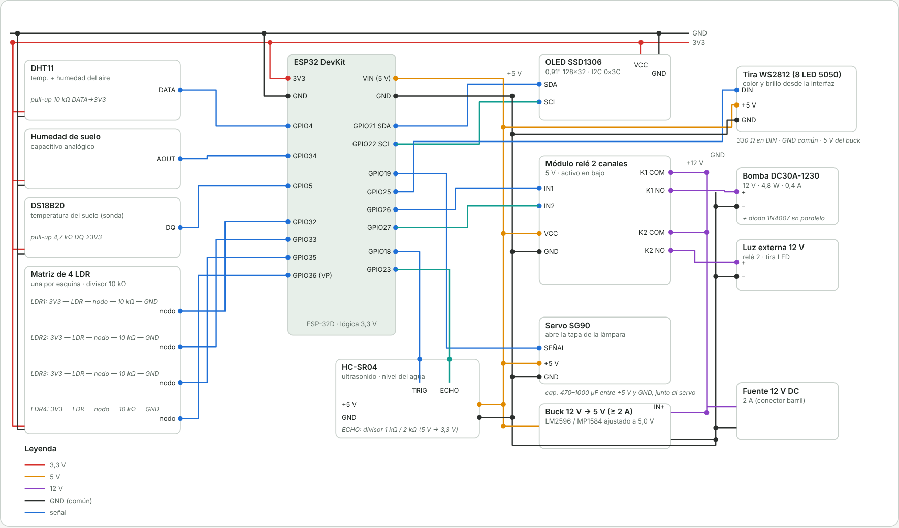

# Conectar el ESP32 (o cualquier cosa que hable HTTP/MQTT)

El backend ya espera los datos; al ESP32 solo le falta enviarlos. **Nada de esto está probado en hardware real**
(se probó con el simulador y con `curl`/`mosquitto_pub`).

## Contrato de telemetría (JSON)

Todos los campos son opcionales: manda solo lo que tengas. El backend convierte `vwc_raw` en % usando la
calibración del dispositivo (`vwc_raw_dry` = seco al aire, `vwc_raw_wet` = en agua; se editan con `PUT /devices/{id}`).

```json
{
  "v": 1,
  "ts": 1760000000,
  "vwc_raw": 2100,
  "soil_t": 24.5, "ph": 6.4, "ec": 620,
  "n": 78, "p": 34, "k": 180,
  "air_t": 27.1, "air_rh": 62, "lux": 18000,
  "tank_ok": true, "pump_on": false, "pump_ma": 0
}
```

`ts` es epoch en segundos (sincroniza con NTP). Si lo omites, el backend usa su propia hora.
Se rechaza un `ts` más de 300 s en el futuro; las fechas pasadas solo se aceptan de dispositivos `sim-*` o por `/import`.

## Pines del montaje

| Pieza | ESP32 | Detalle |
|---|---|---|
| DHT11 | GPIO 4 | `dht_t` y `dht_h` con `param` 11 |
| Humedad de suelo capacitiva | GPIO 34 (ADC1) | clave `vwc_raw` |
| DS18B20 enterrado | GPIO 5 | pull-up de 4,7 kΩ |
| LDR esquinas | GPIO 32 NO · 33 NE · 35 SO · 36 SE | ADC1, llegan como % |
| HC-SR04 | TRIG 18 · ECHO 23 | ECHO a 5 V: divisor 1 kΩ + 2 kΩ |
| Bomba (relé) | GPIO 26 | tope 120 s |
| Luz externa (relé) | GPIO 27 | tope 24 h |
| Servo | GPIO 19 | 5 V externos, GND común |
| Tira LED RGB WS2812 (8 LED) | GPIO 25 (DIN) | 5 V, GND común, 330 Ω en DIN |
| OLED SSD1306 128×32 | SDA 21 · SCL 22 | dirección 0x3C |



El sketch y el backend comparten este mapa: `DEFAULT_CFG` en `esp32_telemetria.ino` y `config_hardware_confirmado()` en
`backend/app/devcfg.py`. Solo se usan ADC1 (32–39): el ADC2 no lee con el WiFi encendido.

## Opción A: MQTT (recomendada)

- Usuario = `device_id` (p. ej. `esp32-01`), contraseña = `MQTT_ESP32_PASSWORD` del `.env`, puerto 1883.
- Publica en `simon/esp32-01/telemetry` cada 5–10 s.
- Estado: `simon/esp32-01/status` con `online` (retained) y Last Will `offline`.
- Escucha `simon/esp32-01/cmd/pump`: `{"cmd_id":"...","seconds":10,"ts":...}` (QoS 1). Enciende la bomba
  `seconds` s y corta siempre con un tope propio; sigue publicando `pump_on`/`pump_ma`.
- Con el ACL, cada dispositivo solo escribe en sus topics y lee sus comandos.

```cpp
// platformio.ini: lib_deps = knolleary/PubSubClient, bblanchon/ArduinoJson
#include <WiFi.h>
#include <PubSubClient.h>
#include <ArduinoJson.h>

WiFiClient net; PubSubClient mqtt(net);
const char* ID = "esp32-01";
unsigned long pumpOffAt = 0;

void onCmd(char*, byte* p, unsigned int n) {
  JsonDocument d; if (deserializeJson(d, p, n)) return;
  int s = constrain((int)d["seconds"], 0, 120);      // tope local de seguridad
  if (s > 0) { digitalWrite(PUMP_PIN, HIGH); pumpOffAt = millis() + s * 1000UL; }
}

void connectMqtt() {
  String t = String("simon/") + ID;
  while (!mqtt.connected()) {
    if (mqtt.connect(ID, ID, MQTT_PASS, (t + "/status").c_str(), 1, true, "offline")) {
      mqtt.publish((t + "/status").c_str(), "online", true);
      mqtt.subscribe((t + "/cmd/pump").c_str(), 1);
    } else delay(2000);
  }
}

void loop() {
  if (!mqtt.connected()) connectMqtt();
  mqtt.loop();
  if (pumpOffAt && (long)(millis() - pumpOffAt) >= 0) { digitalWrite(PUMP_PIN, LOW); pumpOffAt = 0; }
  static unsigned long last = 0;
  if (millis() - last > 5000) {
    last = millis();
    JsonDocument d;
    d["v"] = 1; d["ts"] = (uint32_t)time(nullptr);
    d["vwc_raw"] = analogRead(SOIL_PIN);
    d["air_t"] = readTemp(); d["air_rh"] = readRh();
    d["tank_ok"] = digitalRead(TANK_PIN); d["pump_on"] = digitalRead(PUMP_PIN);
    char buf[384]; size_t n = serializeJson(d, buf);
    mqtt.publish("simon/esp32-01/telemetry", (const uint8_t*)buf, n);
  }
}
```
(`setup()`, WiFi, `configTime(...)`, `mqtt.setServer/ setCallback(onCmd)` y los pines van en tu proyecto.)

## Opción B: HTTP

```bash
# enviar lecturas (sin clave)
curl -X POST http://HOST:8000/ingest/esp32-01 \
  -H "Content-Type: application/json" \
  -d '{"vwc_raw":2100,"air_t":27.1,"air_rh":62,"lux":18000}'
```

## Importar histórico (CSV de la SD / PLX-DAQ)

Convierte las filas a JSON con `ts` en cada una y envía `POST /devices/{id}/import` con
`{"rows":[...]}` (máx. 5000 por llamada).

## Calibrar el sensor de humedad

Mide `vwc_raw` con el sensor en el aire (seco) y sumergido en agua; guarda ambos con
`PUT /devices/esp32-01 {"vwc_raw_dry":3100,"vwc_raw_wet":1300}`. Sin calibrar, los porcentajes son solo orientativos.

## Escena 3D = la maqueta del CAD
La escena usa `frontend/public/maqueta.json` (generado desde `cad/exportar_visor.py`, copia de `cad/visor/partes.json`).
Cada pieza se puede tocar (tarjeta con descripción, lecturas y botón «Controlar»). El agua del depósito sube y baja con
`tank_pct` (o `tank_cm` del HC-SR04), las estacas LDR brillan con `ldr_nw/ne/sw/se`, la tapa de la lámpara la abre el actuador
`servo` con el mecanismo biela-manivela, y la pantalla OLED muestra las lecturas. Si regeneras el CAD, vuelve a copiar `partes.json`.

## Tira LED RGB y ojos
- Tira WS2812 de 8 LED en el GPIO 25: actuador `strip` (driver `ws2812`). Desde el dock de la interfaz eliges color (paleta o selector) y brillo; la maqueta 3D muestra la tira en el frente de la lámpara con ese color. En equipos ya creados, agrégala en Admin → Actuadores → «Tira LED RGB (WS2812)».
- La pantalla OLED muestra unos ojos según el ánimo de la planta (`state.mood`, también publicado en `simon/<id>/mood`).
- En el modelo CAD todavía no hay soporte impreso para la tira: en el 3D es un componente de referencia pegado al frente de la lámpara.
